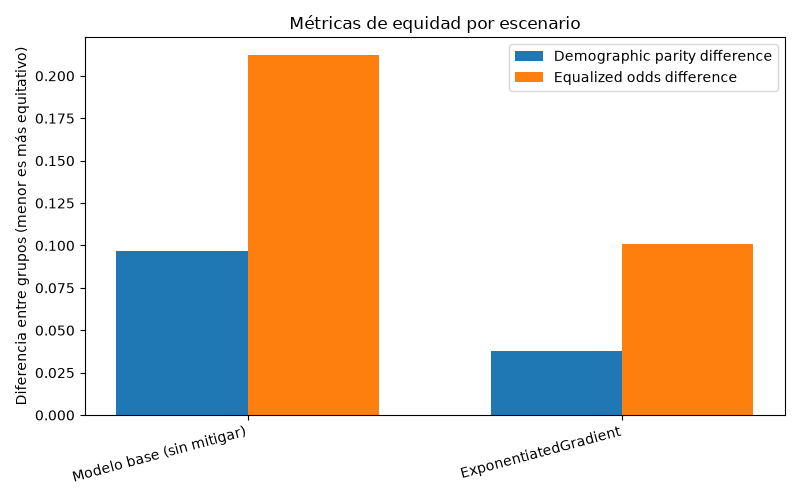
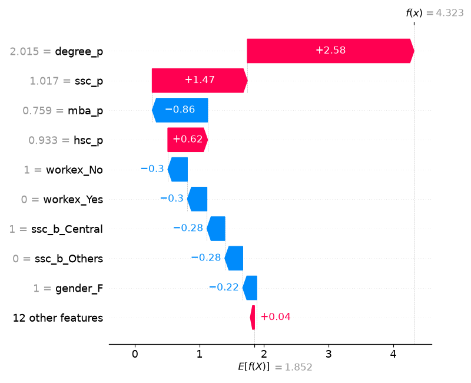
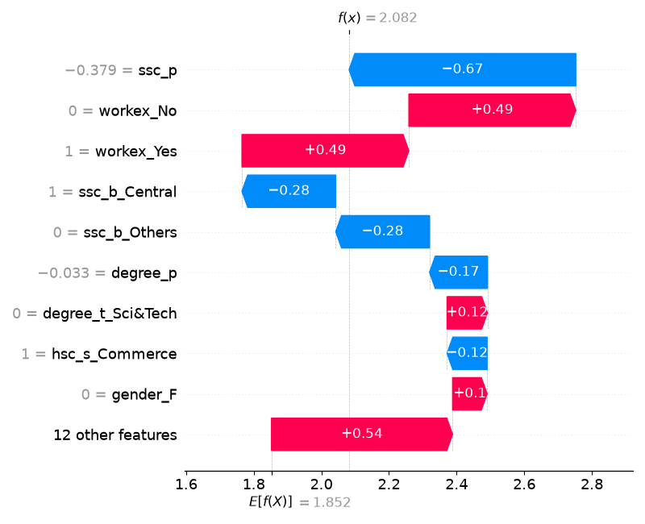
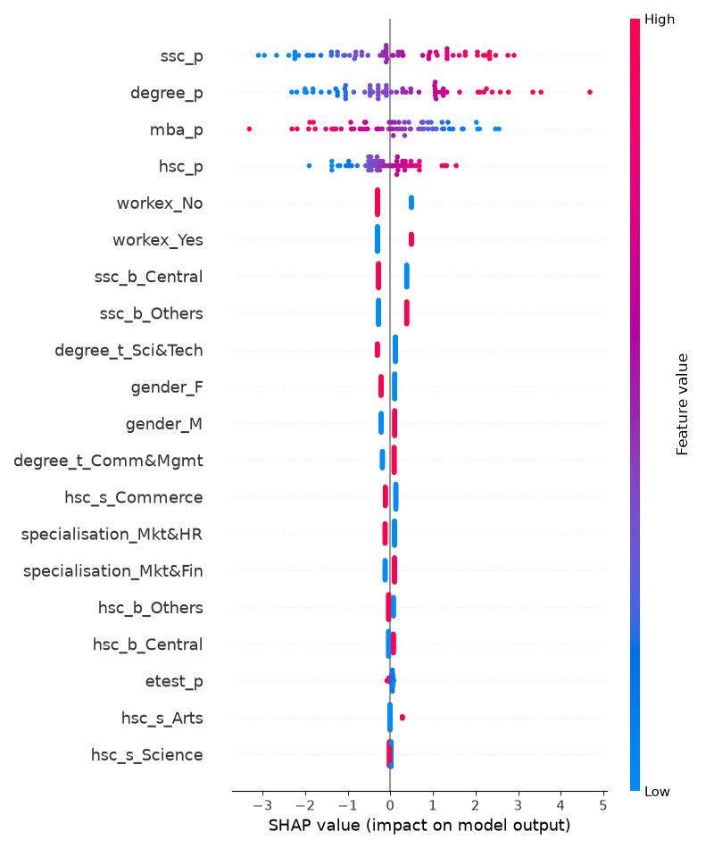

# Evidencias — Auditoría de equidad, mitigación y explicabilidad

_Generado automáticamente el 2026-10-19 19:01._

## Configuración de la corrida

- **Dataset:** data/placement_limpio.csv
- **Columna objetivo:** `status` (clase positiva: `Placed`)
- **Atributo sensible:** `gender`
- **Método de mitigación:** `exponentiated_gradient`
- **Restricción de equidad:** `demographic_parity`
- **Preparación de datos:** exclusión de `sl_no` (identificador) y `salary` (información posterior a la inserción laboral). Se conservaron las 215 filas y 13 columnas, incluida la variable objetivo; las columnas conservadas no presentan valores faltantes.
- **Tratamiento del atributo sensible:** `gender` permanece en el CSV y se utiliza en la auditoría. Los gráficos confirman que la plantilla también lo incluyó como predictor del modelo base, mediante `gender_F` y `gender_M`.
- **Alcance:** experimento académico con Campus Recruitment; las etiquetas `Placed` y `Not Placed` representan inserción laboral observada. No se utilizaron datos ni el modelo de Amazon. La aprobación docente del dataset no está documentada en estas evidencias.
- **Interpretación de cifras:** resultados del modelo redondeados a tres decimales; las diferencias calculadas a partir de ellos son aproximadas.


## Auditoría de equidad — modelo base (pre-mitigación)

- **Exactitud global:** 0.800
- **Demographic parity difference:** 0.097
- **Equalized odds difference:** 0.212

### Métricas por grupo

| Grupo | Exactitud | Tasa de selección |
|---|---|---|
| F | 0.821 | 0.714 |
| M | 0.784 | 0.811 |

El modelo base alcanza una exactitud global de 0.800. La tasa de selección es 0.714 para el grupo F y 0.811 para el grupo M: las postulaciones del grupo femenino reciben una predicción positiva con menor frecuencia, con una brecha aproximada de 9.7 puntos porcentuales. Esta dirección es consistente, en términos descriptivos, con el trato desfavorable hacia las candidatas documentado en el caso de Amazon (Dastin, 2018). La analogía se limita al mecanismo de asignación desigual de oportunidades; el experimento no reproduce el modelo ni los datos de esa empresa.

La exactitud del grupo F (0.821) supera a la del grupo M (0.784). Por lo tanto, una mayor exactitud no implica una mayor tasa de selección ni demuestra equidad. La equalized odds difference de 0.212 indica una brecha de aproximadamente 21.2 puntos porcentuales en al menos una de las tasas de verdaderos positivos o falsos positivos. El indicador agregado no permite identificar cuál de ellas explica la diferencia ni qué grupo presenta el mayor valor.

Las etiquetas representan inserción laboral observada, no una evaluación independiente de idoneidad. Una diferencia entre grupos no demuestra por sí sola discriminación causal. La muestra total tiene 215 registros y las métricas corresponden al subconjunto de prueba, por lo que los tamaños y las tasas de error de cada grupo deben considerarse al evaluar la estabilidad de los resultados.

## Comparación antes / después de la mitigación

| Escenario | Exactitud | Demographic parity diff. | Equalized odds diff. |
|---|---|---|---|
| Modelo base (sin mitigar) | 0.800 | 0.097 | 0.212 |
| ExponentiatedGradient | 0.800 | 0.038 | 0.101 |



ExponentiatedGradient, configurado con la restricción demographic_parity, reduce la demographic parity difference de 0.097 a 0.038, una disminución absoluta de 0.059, equivalente a 5.9 puntos porcentuales. La equalized odds difference también baja, de 0.212 a 0.101, una reducción de 11.1 puntos porcentuales. La exactitud global informada permanece en 0.800. En esta partición de prueba, la mitigación mejora ambos indicadores de equidad sin una pérdida observada de exactitud global.

La reducción de equalized odds es un resultado empírico de esta ejecución y no una garantía de la restricción elegida, que busca igualar tasas de selección. Persisten disparidades en ambos indicadores y la brecha de error condicional continúa siendo mayor que la de selección. La tabla agregada no informa si la menor brecha se obtuvo aumentando las predicciones positivas del grupo F, reduciendo las del grupo M o combinando ambos cambios.

El resultado justifica considerar la mitigación como una mejora preliminar. No basta para aprobar el uso real del sistema: sería necesario examinar tamaños muestrales, matrices de confusión y tasas posteriores por grupo, además de estimar la variabilidad entre particiones o mediante remuestreo. La igualdad de exactitud global tampoco implica que las mismas personas reciban las mismas predicciones. Las conclusiones se restringen a este dataset y a esta evaluación.

## Explicabilidad (SHAP) — modelo base

SHAP se aplica siempre sobre el modelo base, antes de cualquier mitigación: el objetivo es ver qué técnica de auditoría preventiva podría haber detectado el problema antes del despliegue (consigna 4).

### Predicción 0 — mayor influencia del atributo sensible reportada por la plantilla

- Contribución absoluta de `gender`: 0.434
- Predicción del modelo: 1 · Valor real: 1



### Predicción 1 — menor influencia del atributo sensible reportada por la plantilla

- Contribución absoluta de `gender`: 0.204
- Predicción del modelo: 1 · Valor real: 1



### Resumen global



Las explicaciones SHAP aportan indicios que habrían permitido investigar el uso del género antes del despliegue. En el caso 0, gender_F tiene valor 1 y una contribución visible aproximada de -0.22 al resultado del modelo. La contribución absoluta agregada reportada para gender es 0.434. En el caso 1, gender_F tiene valor 0 y una contribución visible aproximada de +0.10; la contribución absoluta agregada reportada es 0.204. Estos valores pertenecen a la escala de salida explicada por SHAP y no son porcentajes de discriminación ni puntos porcentuales de probabilidad.

El caso 0 corresponde a una candidata cuyo resultado predicho y observado es positivo. El caso 1 también presenta una predicción positiva correcta. Por ello, los ejemplos muestran diferencias en la influencia del género, pero no constituyen un rechazo discriminatorio demostrado y un caso certificado de ausencia de discriminación. El segundo valor agregado, 0.204, tampoco es cero. Las denominaciones originales de los archivos son convenciones de la plantilla y no conclusiones del análisis.

El resumen global ubica ssc_p y degree_p entre las características de mayor influencia media absoluta. También muestra aportes asociados a gender_F y gender_M. Su presencia permite investigar asociaciones sensibles aun cuando no sean las variables dominantes. Al tratarse de columnas obtenidas por codificación categórica, la interpretación debe considerar conjuntamente las características correspondientes a gender; no se deben sumar sus valores absolutos e interpretarlos como un efecto causal neto.

SHAP habría servido para señalar características que merecen revisión, complementando las métricas por grupo y pruebas con perfiles comparables. Por sí solo no establece causalidad ni certifica equidad. Además, estas explicaciones corresponden exclusivamente al modelo base: los gráficos no permiten concluir que el modelo mitigado haya dejado de utilizar información relacionada con el género. Este es el vínculo con la auditoría preventiva propuesta en el análisis conceptual.


## Reproducción y registro

El archivo original es `Placement_Data_Full_Class.csv`, del dataset Campus Recruitment. La transformación utilizada elimina exclusivamente las columnas `sl_no` y `salary`, sin eliminar filas ni modificar las demás variables:

```python
import pandas as pd

df = pd.read_csv("data/Placement_Data_Full_Class.csv")
df.drop(columns=["sl_no", "salary"]).to_csv(
    "data/placement_limpio.csv", index=False
)
```

Configuración utilizada en `.env`:

```dotenv
DATASET_PATH=data/placement_limpio.csv
TARGET_COLUMN=status
SENSITIVE_ATTRIBUTE=gender
POSITIVE_LABEL=Placed
MITIGATION_METHOD=exponentiated_gradient
FAIRNESS_CONSTRAINT=demographic_parity
```

Desde `unidad2/`, la ejecución se realiza con `python -m src.main`. Los requisitos de versiones se conservan en el `requirements.txt` de la plantilla. El README deberá indicar la fuente y la preparación del CSV, porque `data/` y `.env` no se versionan según la guía. Las imágenes enlazadas deben conservar sus nombres originales y ubicarse en `outputs/`.

La plantilla genera nuevamente `evidencias.md` al ejecutar el pipeline. Si se realiza otra corrida, se deberán revisar y actualizar estas interpretaciones para que correspondan a los nuevos resultados.

## Referencias

Dastin, J. (2018, 10 de octubre). *Amazon scraps secret AI recruiting tool that showed bias against women*. Reuters. https://www.investing.com/news/stock-market-news/amazon-scraps-secret-ai-recruiting-tool-that-showed-bias-against-women-1637988

Roshan, B. (s. f.). *Campus Recruitment* [Conjunto de datos]. Kaggle. https://www.kaggle.com/datasets/benroshan/factors-affecting-campus-placement
