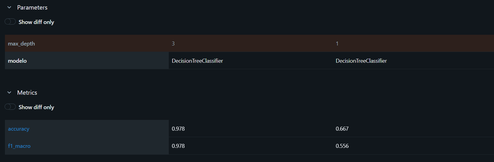
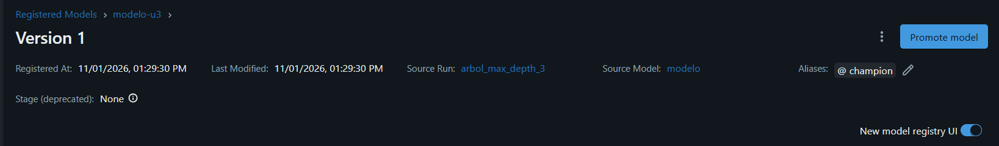
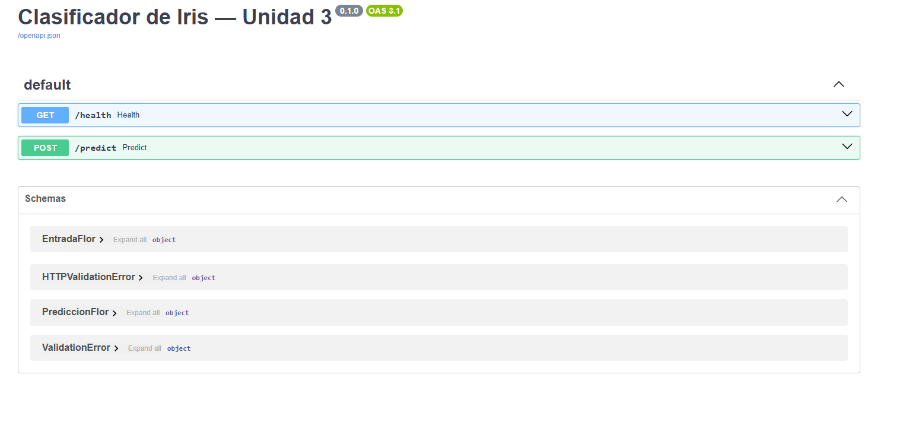
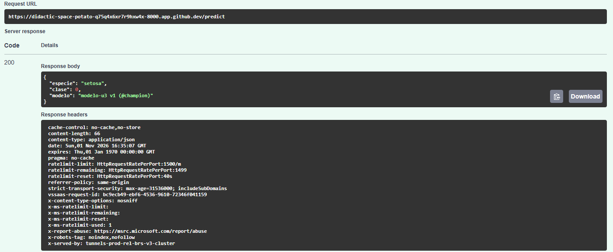
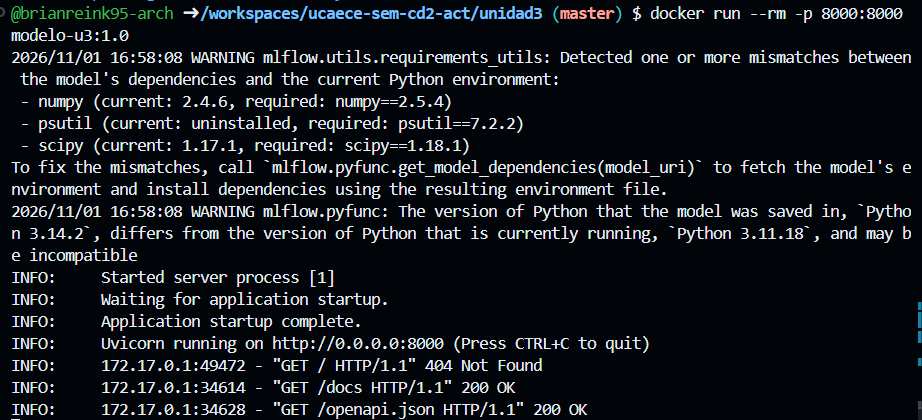

# Resultados — Unidad 3: MLOps/LLMOps

**Estudiante:** Brian Reinke  
**Fecha:** 1 de noviembre de 2026

---

## Consigna 6: Preparación del entorno

---

## Consigna 7: Experimentación y registro con MLflow

| Corrida | max_depth | accuracy | f1_macro |
|---------|-----------|----------|----------|
| arbol_max_depth_1 | 1 | 0.667 | 0.556 |
| arbol_max_depth_3 | 3 | 0.978 | 0.978 |

**Versión registrada:** modelo-u3 v1 (@champion), corrida con max_depth = 3.

> Al aumentar la profundidad de 1 a 3, el accuracy pasó de 0.667 a 0.978 y el F1 macro de 0.556 a 0.978 en el conjunto evaluado.  
> La segunda corrida representó mejor las diferencias entre especies y fue seleccionada para el registro.  
> Conservar todas las corridas, incluidas las peores, permite comparar alternativas y rastrear qué parámetros produjeron cada resultado.  
> MLflow registra esa relación en la práctica; el diseño teórico propone una trazabilidad equivalente mediante Azure SQL, vinculada con las versiones de código, modelo, prompt, contexto y datos.

---

## Consigna 8: Serving con FastAPI

| Entrada | Respuesta de la API |
|---------|---------------------|
| `{"largo_sepalo_cm":5.1,"ancho_sepalo_cm":3.5,"largo_petalo_cm":1.4,"ancho_petalo_cm":0.2}` | HTTP 200; `especie: setosa`, `clase: 0`, `modelo: modelo-u3 v1 (@champion)`. |
| `{"largo_sepalo_cm":6.0,"ancho_sepalo_cm":2.7,"largo_petalo_cm":4.5,"ancho_petalo_cm":1.4}` | HTTP 200; `especie: versicolor`, `clase: 1`, `modelo: modelo-u3 v1 (@champion)`. |
| `{"largo_sepalo_cm":6.9,"ancho_sepalo_cm":3.1,"largo_petalo_cm":5.8,"ancho_petalo_cm":2.2}` | HTTP 200; `especie: virginica`, `clase: 2`, `modelo: modelo-u3 v1 (@champion)`. |
| `{"largo_sepalo_cm":"abc","ancho_sepalo_cm":3.1}` | HTTP 422; `float_parsing` en `largo_sepalo_cm` y `missing` en `largo_petalo_cm` y `ancho_petalo_cm`. |

Evidencias adicionales: [versicolor](capturas/8_serving/8_c_04_versicolor_respuesta.png), [virginica](capturas/8_serving/8_c_06_virginica_respuesta.png) y [entrada inválida](capturas/8_serving/8_c_08_invalida_respuesta_422.png).

> La API rechazó la entrada inválida con HTTP 422 porque contenía el valor no numérico `"abc"` y omitía las dos medidas del pétalo.  
> FastAPI y Pydantic detectaron estos errores antes de ejecutar la función de predicción, por lo que la solicitud no llegó a la inferencia del modelo.  
> La respuesta identificó los campos afectados y el motivo de cada error.  
> Este control evita predicciones sobre datos que incumplen el contrato y permite que el sistema consumidor corrija la solicitud.

---

## Consigna 9: Containerización con Docker

Evidencias adicionales: [construcción de modelo-u3:1.0](capturas/9_docker/9_a_01_construccion_imagen.png) y [predicción desde el contenedor](capturas/9_docker/9_b_02_prediccion_respuesta_200.png).

> Las imágenes `modelo-u3:1.0` y `modelo-u3:1.1` permitirían aplicar blue-green ejecutándolas en contenedores y puertos diferentes.  
> La versión 1.0 atendería el tráfico mientras se valida la 1.1; después se cambiaría el enrutamiento, conservando la anterior para rollback.  
> En la práctica se ejecutó únicamente la imagen 1.0 y se obtuvo HTTP 200, `setosa`, clase 0, con `modelo-u3 v1 (@champion)`.  
> MLflow advirtió diferencias entre Python 3.14.2 del modelo guardado y Python 3.11.18 del contenedor, además de diferencias en dependencias.  
> Esas advertencias no impidieron la prueba, pero su éxito no demuestra compatibilidad completa entre los entornos.

---

## Paso opcional: LLMOps con Groq

No realizado. No se ejecutó la comparación de prompts ni se registraron métricas o capturas para este paso opcional sin puntaje.
